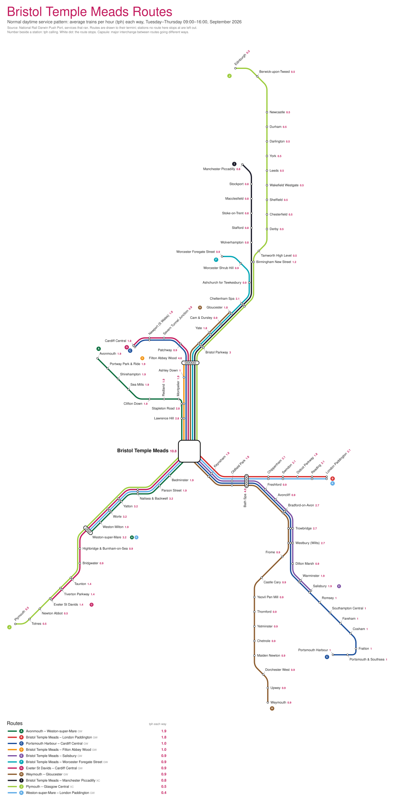

# rail-network-visualiser

Pick a station and get an Avanti-style route map of the trains that serve it: every route drawn in
full to its terminus as a coloured lane, a dot wherever a route stops, route letters at the ends,
and the **trains per hour (tph)** on every station and route.



More examples: [Doncaster](docs/examples/DON.svg) · [Reading](docs/examples/RDG.svg)

The maps are built from real timetables (the "normal" service: Tuesday–Thursday, 09:00–16:00, so no
peaks and no early/late workings) and laid out automatically. They are schematic: distances are
not to scale, but the order of stations along every route is real.

## How it works

```
services (CSV)  ──►  routes  ──►  station graph  ──►  tree layout  ──►  lanes + labels  ──►  SVG
 one row per          clustered     which stations     octilinear         rule checks, then
 train that ran       by stopping   a fast train       spokes from the    pick the tightest
                      pattern       passes             hub                spacing that passes
```

1. **Routes** (`station_route_map.discover_routes`). Every service that calls at the hub inside the
   window is grouped by operator and stopping pattern. Patterns that mostly overlap are merged, so a
   short working counts towards the route it is part of. tph is trains per hour *each way*. At most
   12 routes (the busiest) are drawn, and rarer ones (< 0.3 tph) are dropped.
2. **Stations a fast train passes.** Only stations that some drawn route stops at appear. Between two
   stops of a route, the stations it passes (and another route stops at) are found from the
   National Rail route map network, and from a "flat triangle" rule when that is unavailable.
3. **Layout** (`station_route_map.layout`). The graph becomes a spanning tree that keeps the most
   traffic (the busier of two parallel corridors stays straight; the quieter one hangs off it as a
   spur). Each branch leaves the hub in the 45° direction closest to its real compass bearing.
4. **Lanes.** Routes sharing track run as parallel lanes. Lane order follows where each route goes
   *next*, so lines only change side where they diverge. A lane keeps its offset along a bundle, so
   nothing wiggles after a junction.
5. **Labels.** Placed greedily around the real lines, starting within 30 px of their own dots and
   closer to them than to any other station's dots; a thin leader line is drawn when that is not
   possible.
6. **Spacing search** (`hub_map.build_map`). The map is laid out at a series of spacings (250 px down
   to 47 px between stations). Each is checked against the rules below; the tightest spacing with
   the fewest hard failures wins.

### The rules (all measured, and printed for every map)

| Rule | Checked as |
|---|---|
| No dot overlaps another | dots at least 8.4 px apart |
| Interchange marks only at major stations | a capsule needs ≥ 3 tph calling **and** routes that both stop there going different ways. A station merely served by many routes is not marked, and routes that do not stop get no mark |
| No line hidden under another | lines of different routes never run within a lane gap of each other |
| No crossings | none outside the hub and interchange capsules |
| No overlapping text | labels clear of lines, dots and each other, and tied to their own station |
| Routes drawn in full | to the real terminus; at most 12 routes |

The per-map report looks like
`{'dot_overlap': 0, 'label_collision': 0, 'crossings': 0, 'branch_overlap': 0, 'dot_on_line': 2, 'leader_lines': 49}`.

## Quick start

```bash
git clone git@github.com:iiAnderson/rail-network-visualiser.git && cd rail-network-visualiser
python3 -m venv .venv && . .venv/bin/activate && pip install -r requirements.txt
python -m pytest tests            # smoke test on an invented network, no data needed

# one station (CRS code), then open maps/BRI.svg
python src/hub_map.py BRI --patterns data/national_patterns.csv --tiplocs data/tiplocs.csv \
    --network data/nr_schematic.json

# many stations, in parallel, resumable; also writes maps/index.html (a station selector)
python src/generate_all.py --patterns data/national_patterns.csv --tiplocs data/tiplocs.csv \
    --network data/nr_schematic.json --top 300 --workers 6
open maps/index.html
```

A single busy station takes 1–6 minutes (the spacing search is the cost), so `generate_all.py`
runs several at once.

## Inputs

`data/` is git-ignored: nothing in it is committed.

**`national_patterns.csv`**: one row per passenger service that ran, with these columns:

| column | meaning |
|---|---|
| `service_date`, `rid`, `train_id` | identifiers (`service_date` is used to count days) |
| `toc` | operator code, e.g. `GW` |
| `pattern` | comma-separated **TIPLOCs** of the calling points, in order |
| `times` | comma-separated `HH:MM:SS` for each calling point (departure, else arrival) |

**`tiplocs.csv`**: `TiplocCode, CrsCode, StationName, easting, northing` (OSGB grid, metres). The
CRS code is what you pass on the command line; coordinates are used to point each branch the right
way. Stations missing here still work, but get their TIPLOC as a name and no bearing.

[`sql/national_patterns.sql`](sql/national_patterns.sql) and [`sql/tiplocs.sql`](sql/tiplocs.sql)
produce both from the `normalised_v1` and `tiplocs` tables of the
author's `darwin-storage` pipeline (National Rail Darwin feed, on AWS Athena);
[`tools/fetch_athena.sh`](tools/fetch_athena.sh) runs them. Any source with the same columns works.
Choose typical midweek days from a month with no big disruption.

**`nr_schematic.json`** (optional): the line network read from the National Rail "All Stations Route
Map" PDF, used only to work out which stations a fast service passes between two stops. Without it
the maps still build, using the flat-triangle rule alone (a little less accurate on busy
corridors). Build it from your own copy of the PDF:

```bash
python3 -m venv /tmp/nrvenv && /tmp/nrvenv/bin/pip install pymupdf
/tmp/nrvenv/bin/python -I src/extract_nr_schematic.py National_Rail_All_Stations_Route_Map.pdf data/nr_schematic.json
```

## Repository layout

```
src/hub_map.py               the map builder and rule checks (start here)
src/station_route_map.py     data loading, route discovery, tree layout, shared helpers
src/nr_route_map.py          loads the PDF-derived network; label placement helpers
src/extract_nr_schematic.py  one-off: PDF -> data/nr_schematic.json
src/generate_all.py          batch runner + station selector page
sql/  tools/                 how to get the input CSVs
web/index.html               selector template (copied into maps/)
docs/examples/               three finished maps
tests/                       smoke test
```

`nr_route_map.py` also contains an earlier experiment that drew the maps at the PDF's own
spacing. It is kept for its helper code; the maps were clearer on the evenly spaced tree layout.

## Tuning

Everything is a constant at the top of `src/hub_map.py` / `src/station_route_map.py`:
`WINDOW` (hours), `MAX_ROUTES`, `MIN_TPH`, `SPACINGS`, `MAJOR_TPH`, `LABEL_MAX`, `PITCH` (lane gap).

## Known limitations

- Where two corridors join the same places (Doncaster–Sheffield via Rotherham or via Meadowhall) the
  diagram has no loops: the quieter corridor becomes a spur and a route using it runs out to the
  end and back along the same lane.
- Very dense areas (Reading–Swindon–Gloucester, London) can still end with a few label clashes or
  one crossing; the report says how many. Stations where the report lists failures are best checked by eye.
- Stations not in `tiplocs.csv` (e.g. the Elizabeth line) show a TIPLOC as their name.
- One day-type only (midweek daytime). tph is an average over those hours, so it is fractional
  (1.3 tph, not "2"); it is not a timetable promise.

## Data and licensing

Code: GPL-3.0 (see `LICENSE`). The data is not part of this repository:

- Train data comes from the National Rail Darwin feed (Open Rail Data); check its terms before
  republishing maps built from it.
- The route map PDF is © Rail Delivery Group and "must not be reproduced in any form without
  permission". This repo ships only the extraction script, not the PDF nor anything extracted from it.
